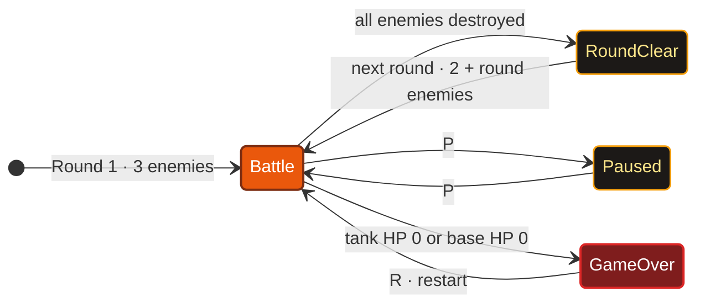
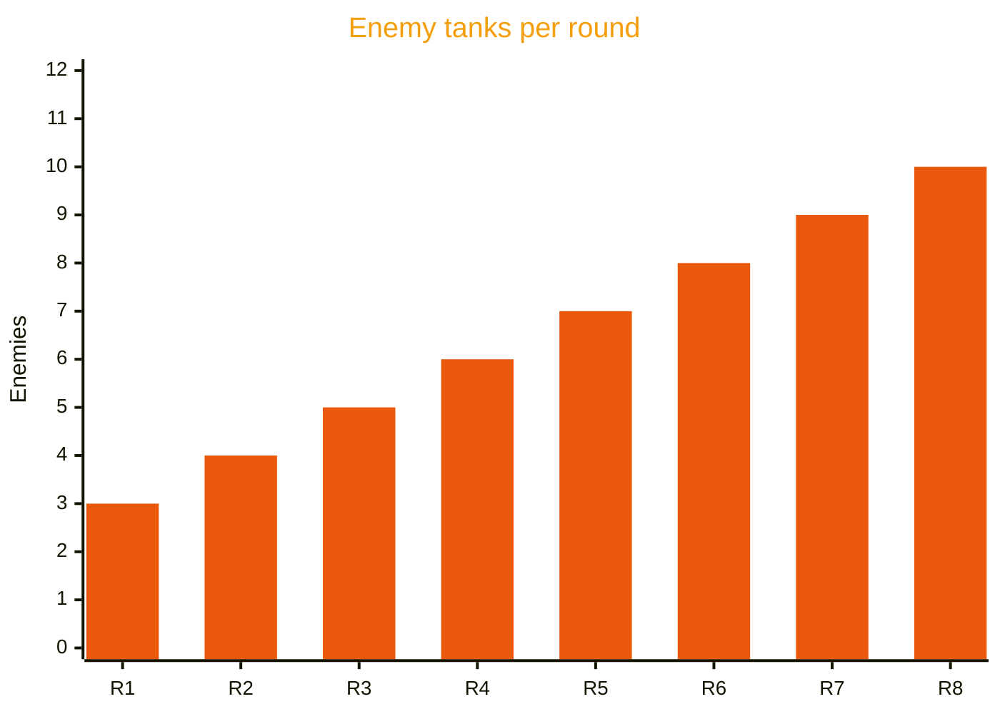
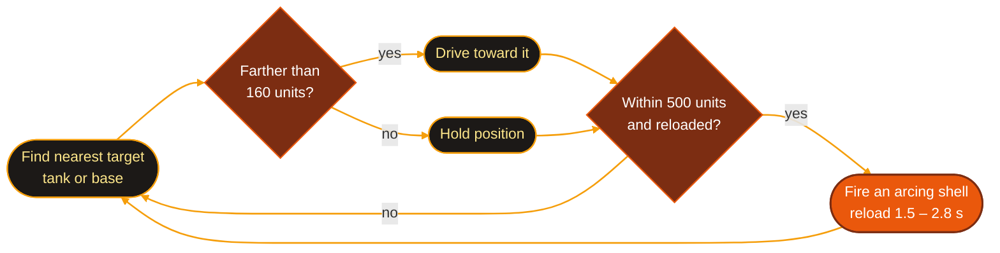

<div align="center">


<a href="https://github.com/sabikswanan/Tank-Battle-"></a>

<br/>

<a href="https://github.com/sabikswanan/Tank-Battle-/blob/main/tank_battle%20video.mp4"></a>


<br/><br/>

**[Overview](#overview)** &nbsp;|&nbsp;
**[Controls](#controls)** &nbsp;|&nbsp;
**[Gameplay](#gameplay)** &nbsp;|&nbsp;
**[Features](#features)** &nbsp;|&nbsp;
**[Under the Hood](#under-the-hood)** &nbsp;|&nbsp;
**[Getting Started](#getting-started)** &nbsp;|&nbsp;
**[Author](#author)**

</div>

<br/>

<a name="overview"></a>

## 🎮 Overview

**Tank Battle 3D** is a wave-based tank defense game. You command a tank in a circular arena,
enemy tanks roll in from the far side, and your job is to keep both **your tank** and **your base**
alive. Every cleared round brings a bigger wave.

> [!NOTE]
> The entire game — rendering, physics, enemy AI, HUD and menus — lives in **one Python file of
> about 1,000 lines**, built only with the OpenGL and GLUT functions from the course lab templates.
> No game engine, no textures, no external assets.

Built for **CSE423 — Computer Graphics** at **BRAC University**.

<div align="center">

<a href="https://github.com/sabikswanan/Tank-Battle-/blob/main/tank_battle%20video.mp4"></a>

</div>

<br/>

<a name="controls"></a>

## 🕹️ Controls

<table>
<tr>
<td valign="top" width="50%">

**Driving & combat**

| Key | Action |
|:---:|---|
| <kbd>W</kbd> / <kbd>S</kbd> | Drive forward / backward |
| <kbd>A</kbd> / <kbd>D</kbd> | Turn left / right |
| <kbd>Space</kbd> or <kbd>Left Click</kbd> | Fire a shell |

</td>
<td valign="top" width="50%">

**Camera & game**

| Key | Action |
|:---:|---|
| <kbd>V</kbd> | Switch camera (Orbit ↔ Follow) |
| <kbd>←</kbd> / <kbd>→</kbd> | Rotate the orbit camera |
| <kbd>P</kbd> | Pause / resume |
| <kbd>R</kbd> | Restart |

</td>
</tr>
</table>

<br/>

<a name="gameplay"></a>

## ⚔️ Gameplay



### Waves get bigger every round



### Combat numbers

<table>
<tr>
<td valign="top" width="50%">

**You vs. them**

| Event | Effect |
|---|---|
| Your shell hits an enemy | **−25 HP** (enemies have 30) |
| Enemy destroyed | **+10 score** |
| Round cleared with base at full HP | **+25 bonus** |

</td>
<td valign="top" width="50%">

**Them vs. you**

| Event | Effect |
|---|---|
| Enemy shell hits your tank | **−12 HP** (of 100) |
| Enemy shell hits your base | **−8 HP** (of 100) |
| Tank or base reaches 0 HP | **Game over** |

</td>
</tr>
</table>

### Power-ups

| Pickup | Effect | Duration |
|---|---|:---:|
| 🟡 **Rapid Fire** | Time between shots drops from **0.45 s to 0.18 s** | 8 s |
| 🔵 **Speed Boost** | Tank moves **1.6×** faster | 8 s |

Two power-ups spawn at the start of every game and more appear during battle (up to four at once).
Active boosts show as pulsing icons with a countdown at the top of the screen.

### How enemies think



<br/>

<a name="features"></a>

## ✨ Features

<table>
<tr>
<td valign="top" width="50%">

#### 🎯 Combat
- Shells follow a **gravity-based arc**
- Enemies **chase and shoot** at the nearest target
- **Obstacles** block movement and the view
- Tank **flashes and shrinks** when hit

</td>
<td valign="top" width="50%">

#### 🧭 Camera & HUD
- **Orbit** and **Follow** camera modes
- **Minimap** in the corner
- **Capsule HP bars** that turn green → yellow → red and pulse below 40%
- Score shown as a **spinning, bobbing coin**

</td>
</tr>
<tr>
<td valign="top" width="50%">

#### 🌄 World
- Circular arena with animated, shimmering ground rings
- Gradient **sky dome** with a glowing sun and distant hills
- Fort-style **base** with towers, a pulsing beacon and orbiting orbs
- Crates topped with **floating, spinning gems**

</td>
<td valign="top" width="50%">

#### 🔁 Game flow
- **Endless waves** that grow every round
- **Rapid Fire** and **Speed Boost** power-ups
- **Pause** without closing the game
- **Game over** screen with instant restart

</td>
</tr>
</table>

<details>
<summary><b>All 14 features mapped to the code</b></summary>
<br/>

| # | Feature | Where it lives |
|:---:|---|---|
| 1 | Player tank (boxes + cylinder barrel) | `draw_tank()` |
| 2 | Turret moves with the tank body | `update()` |
| 3 | Enemy tanks chase the nearest target and fire from range | `update_enemies()`, `enemy_fire()` |
| 4 | Rounds that get harder each time | `next_round_if_clear()`, `spawn_wave()` |
| 5 | Shells arc through the air with gravity | `update_shells()` |
| 6 | Obstacles block view and movement | `draw_obstacles()`, `blocked()` |
| 7 | Base with its own health bar | `draw_hp_capsule()` |
| 8 | Tank flashes and shrinks when hit | `draw_player_tank()` |
| 9 | Two camera views (orbit + follow) | `setup_camera()` |
| 10 | Power-ups (rapid fire / speed boost) | `update_powerups()`, `draw_powerups()` |
| 11 | Minimap | `draw_minimap()` |
| 12 | Animated coin score | `draw_score_coins()`, `draw_coin()` |
| 13 | Pause key | `keyboard_down()` |
| 14 | Game over screen and restart | `draw_hud()`, `reset_game()` |

</details>

<br/>

<a name="under-the-hood"></a>

## 🔧 Under the Hood

| Area | Approach |
|---|---|
| **Game loop** | All animation runs in GLUT's `idle()` callback using a `time.time()` delta, so enemies, shells and effects move at the same speed on any machine |
| **Projectile physics** | Each shell carries a 3D velocity; gravity (`GRAV = 500`) pulls its vertical speed down every frame to create the arc |
| **Collision** | Distance checks between shells, tanks, the base and obstacles, plus an arena boundary test |
| **Enemy AI** | Target selection by distance, steering toward the target, and a randomised reload timer |
| **Rendering** | Every object is built from OpenGL primitives — quads, cubes, cylinders, spheres and points — with no textures or lighting |
| **Constraints** | Only GL/GLUT functions from the lab templates; `glutTimerFunc` deliberately not used |

<br/>

<a name="getting-started"></a>

## 🚀 Getting Started

```bash
git clone https://github.com/sabikswanan/Tank-Battle-.git
cd Tank-Battle-
pip install PyOpenGL PyOpenGL_accelerate
python tank_battle.py
```

> [!TIP]
> Press <kbd>V</kbd> right away to try the follow camera, and grab a 🟡 power-up early — rapid fire
> makes the first waves much easier.

<br/>

## 🗺️ Roadmap

- [ ] Sound effects for firing, hits and explosions
- [ ] New enemy types with different speed, armour and range
- [ ] Persistent high-score table
- [ ] Hold-to-drive movement for smoother control

<br/>

<a name="author"></a>

## 👤 Author

<div align="center">

### Sabik Swanan

B.Sc. in Computer Science · BRAC University

<br/>

<a href="https://github.com/sabikswanan"></a>
<a href="https://www.linkedin.com/in/sabikswanan"></a>
<a href="https://mail.google.com/mail/?view=cm&fs=1&to=sabikswanan@gmail.com"></a>

<br/><br/>

<sub>⭐ Star this repo if you enjoyed the game</sub>


</div>
